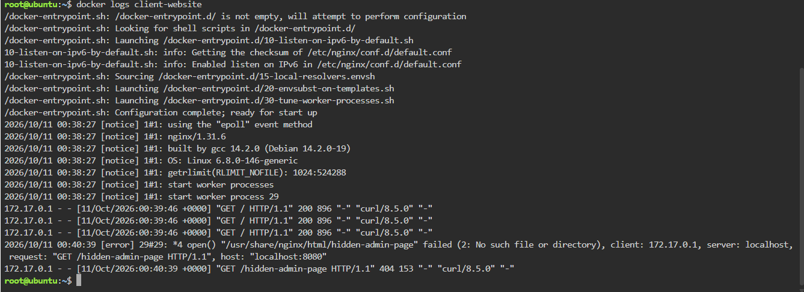

# Container Observability

## Checkpoint 4: Application Logs

### 404 Error Log line

```text
2026/10/11 00:40:39 [error] 29#29: *4 open() "/usr/share/nginx/html/hidden-admin-page" failed (2: No such file or directory), client: 172.17.0.1, server: localhost, request: "GET /hidden-admin-page HTTP/1.1", host: "localhost:8080"
```

### Why Application Logs Are Vital for Troubleshooting

Application logs record exactly what happened on the server, including the time, the requested page, and the result, which lets engineers find the cause of a problem instead of guessing. In this case, the log shows that a request for a page that does not exist failed, so an engineer can quickly confirm the error came from a missing file rather than a server crash.

