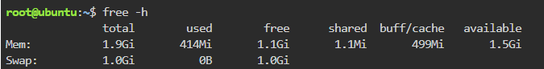
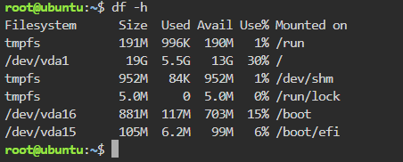

# System Baseline Report

## Host System Baseline

| Metric | Value | Command Used |
|---|---|---|
| Total RAM | 1.9Gi | `free -h` |
| Total Storage (root `/`) | 19G | `df -h` |

## Why Check Disk Space is critical before a massive traffic sruge?

Checking disk space before a traffic surge is critical because a sudden increase in users generates more logs and data, and a full disk can cause the web server to crash or stop working entirely.

## Screenshots

