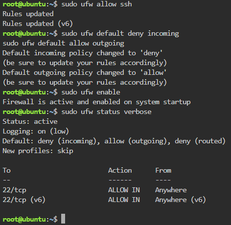
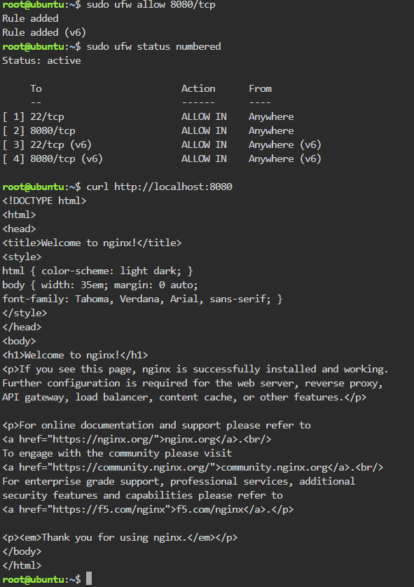

# Firewall Configuration

## Commands Used

### Allow SSH

**Command executed:**

```bash
sudo ufw allow ssh
```

### Set the Default Deny Policy

**Command executed:**

```bash
sudo ufw default deny incoming
sudo ufw default allow outgoing
```

### Allow Port 8080

**Command executed:**

```bash
sudo ufw allow 8080/tcp
```

## What Would Happen If `sudo ufw enable` Ran Before `sudo ufw allow ssh`?

If `sudo ufw enable` were run before `sudo ufw allow ssh`, the Default Deny policy would block all incoming connections, including SSH, and the administrator would be locked out of the server.

## Screenshots


