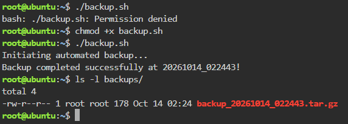
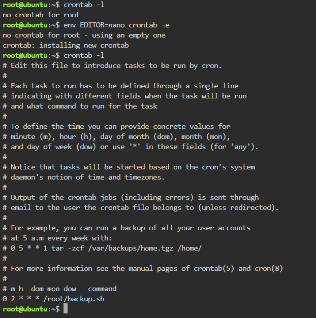

# Backup Script Guide

## The Backup Script (`backup.sh`)

```bash
#!/bin/bash
# Automated Backup Script for CloudNova Technologies

SOURCE_DIR="app-data"
BACKUP_DIR="backups"
TIMESTAMP=$(date +"%Y%m%d_%H%M%S")

echo "Initiating automated backup..."

# Create the backup directory if it does not exist
mkdir -p $BACKUP_DIR

# Compress the source directory into a tarball (.tar.gz)
tar -czf $BACKUP_DIR/backup_$TIMESTAMP.tar.gz $SOURCE_DIR

echo "Backup completed successfully at $TIMESTAMP!"
```

## What Did `chmod +x` Do?

```bash
chmod +x backup.sh
```

The `chmod +x` command added execute permission to the `backup.sh` file. By default, Linux treats a new file as plain text and returns a "Permission denied" error if it is run, so this permission is needed before the script can run as a program.

## The Cron Expression

```text
0 2 * * * /root/backup.sh
```

| Field | Value | Meaning |
|---|---|---|
| Minute | `0` | At minute 0 of the hour |
| Hour | `2` | At 2 AM (24-hour clock) |
| Day of Month | `*` | Every day of the month |
| Month | `*` | Every month |
| Day of Week | `*` | Every day of the week |

Together, this schedule runs `/root/backup.sh` every night at exactly 2:00 AM without anyone needing to run it manually.

## Screenshots


